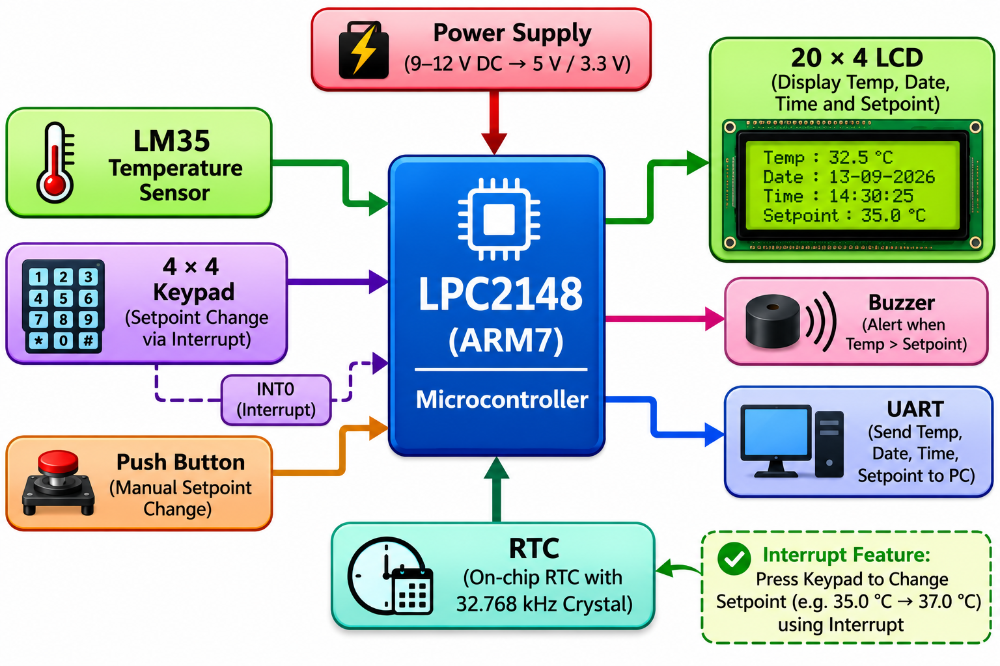
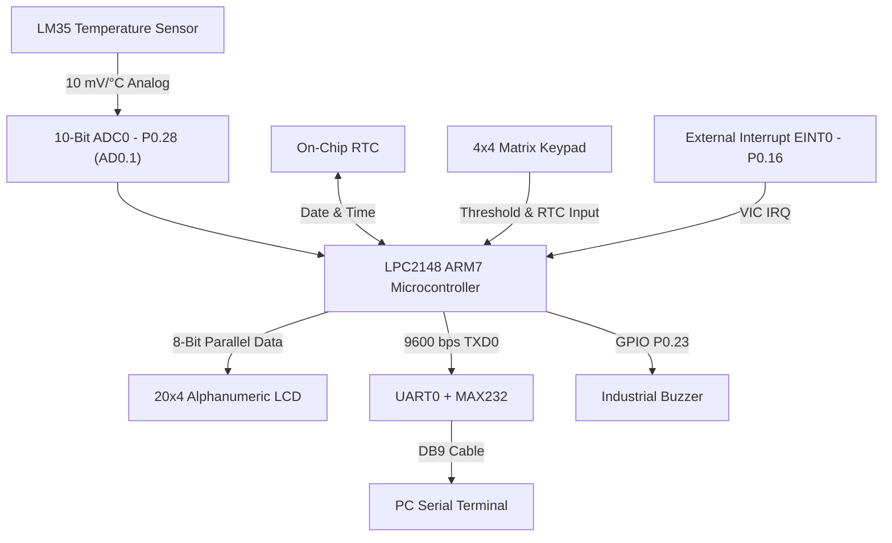
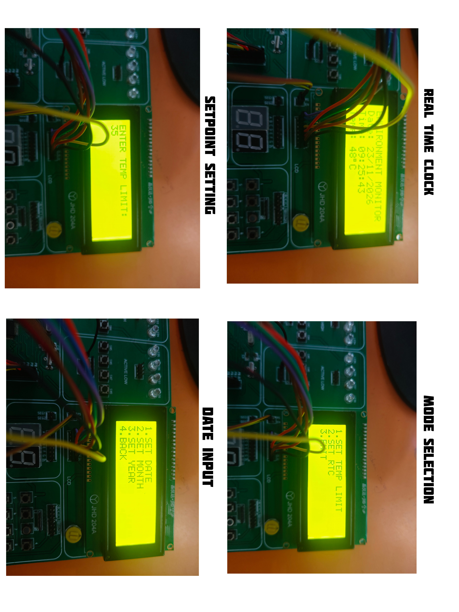
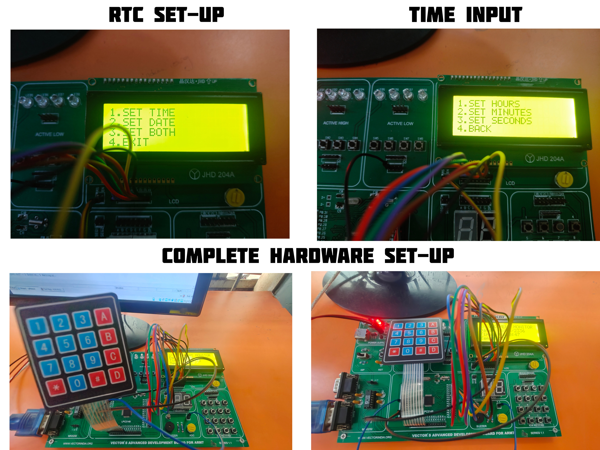
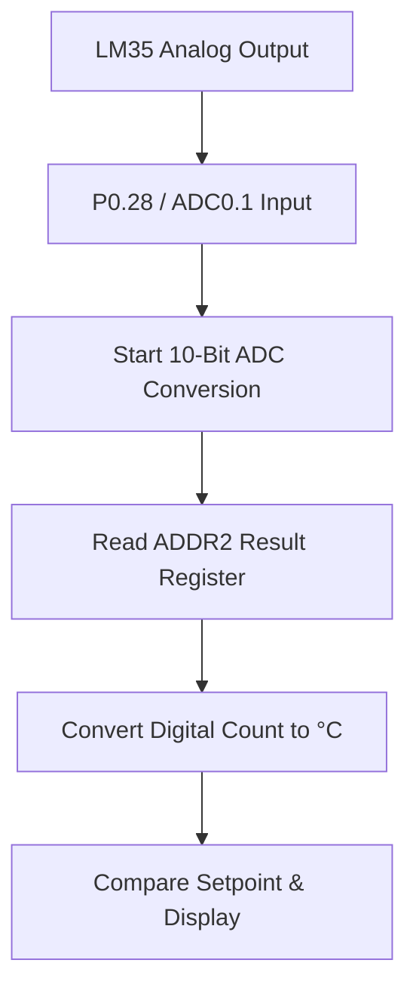
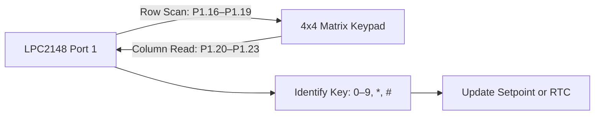
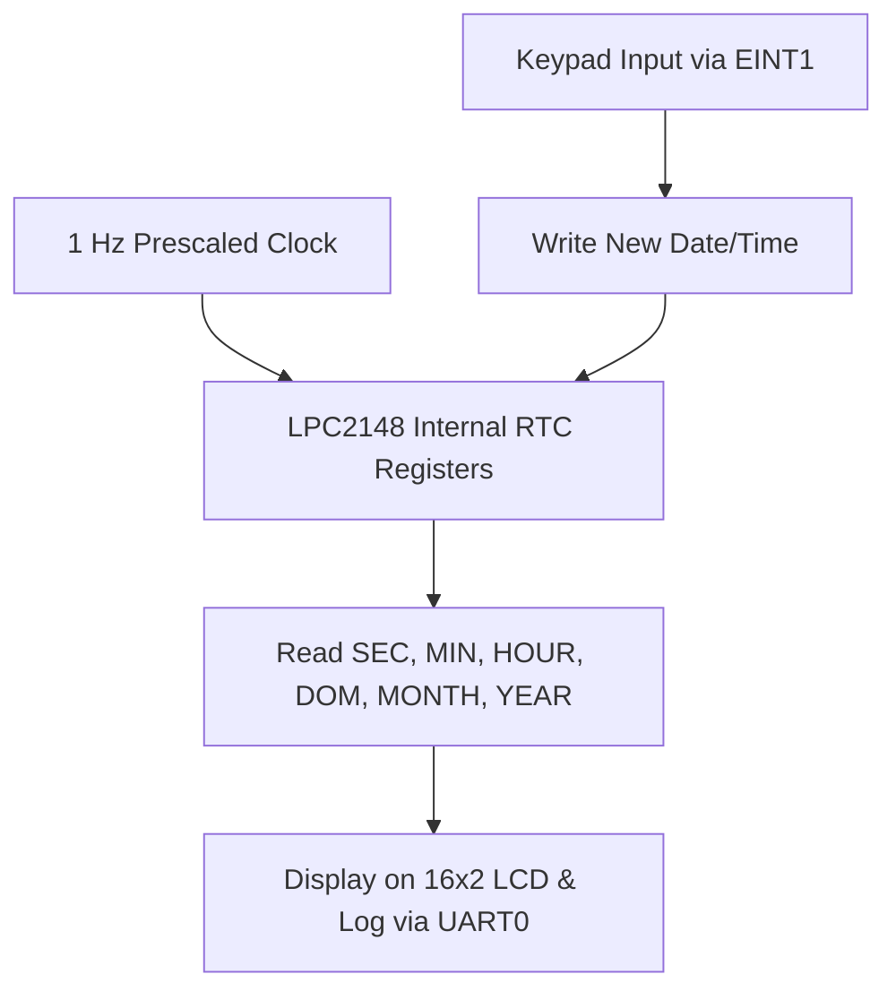
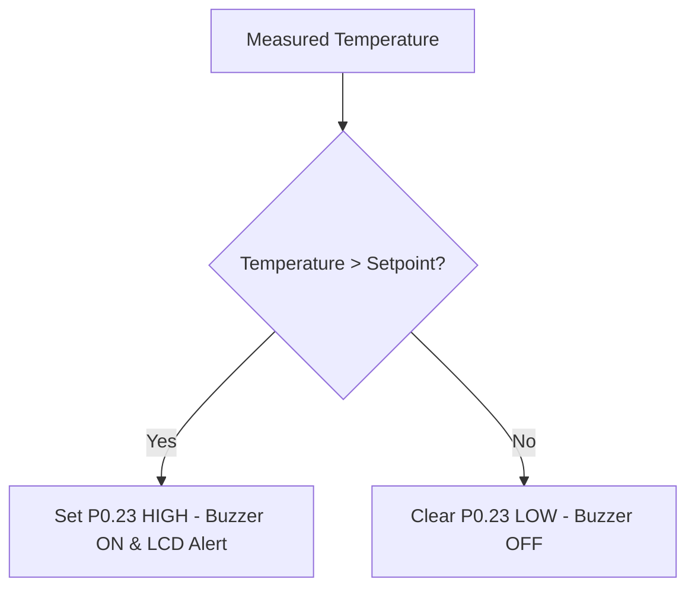
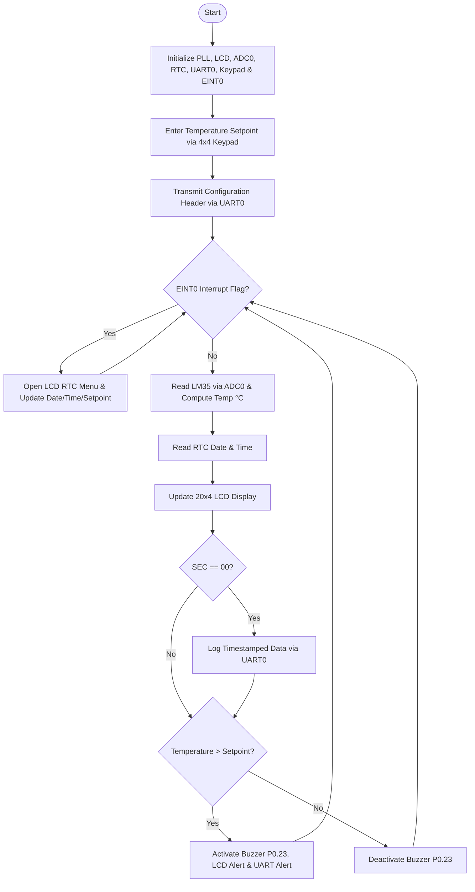

# ⚡ Industrial Environmental Monitoring and Timestamp-Based Data Logging System
<p align="center">
  
  
  
</p>

<p align="center">
  
  
  
</p>

<p align="center">
  
  
  
</p>

---

## 1. Project Overview

The **Industrial Environmental Monitoring and Timestamp-Based Data Logging System** is a bare-metal embedded systems project developed using the **NXP LPC2148 ARM7** microcontroller.

The primary goal of this project is to continuously monitor ambient industrial temperature, display real-time temperature alongside live calendar date and time on a **20×4 LCD**, trigger an audible **buzzer alert** upon temperature threshold violations, and transmit timestamped environmental monitoring data to a host PC via **UART0** for data logging and analysis.

An **LM35** precision analog temperature sensor measures the surrounding temperature (`10 mV/°C`), and the LPC2148's built-in **10-bit ADC** converts the analog voltage into digital data. At startup, the operator configures a custom temperature setpoint using a **4×4 matrix keypad** (`*` backspace and `#` confirmation). During normal operation, pressing an **External Interrupt (`EINT0`)** switch pauses monitoring and opens an interactive keypad menu featuring **SET SETPOINT** and **SET RTC** options. The RTC submenu provides **SET TIME**, **SET DATE**, and **SET BOTH** (time and date) configurations, allowing the operator to modify the internal **Real-Time Clock (RTC)** using keypad input (`HH:MM:SS` and `DD/MM/YYYY`).

When the measured temperature exceeds the configured setpoint (e.g., `35.0 °C`), the firmware activates the industrial buzzer, displays `BUZZER ALERT!!` on the LCD, and immediately transmits a `[!!] TEMPERATURE ALERT` notification over **UART0**. The system also periodically transmits temperature readings with RTC timestamps to the host PC, enabling continuous environmental monitoring and timestamp-based data logging.

---

## 2. Project Objectives
- Monitor industrial environmental temperature continuously in real time.
- Measure ambient temperature using an **LM35** analog temperature sensor (`10 mV/°C`).
- Convert the analog sensor output into a digital value using the LPC2148's built-in 10-bit ADC.
- Allow custom temperature setpoint configuration at startup using a 4×4 Matrix Keypad.
- Display live temperature, date, time, and alert messages on a **20×4 Alphanumeric LCD**.
- Maintain accurate wall-clock time and calendar date using the on-chip Real-Time Clock **(RTC)**.
- Use an External Interrupt (`EINT0`) switch connected to **P0.16** to access the interactive operator menu for temperature **setpoint** and **RTC** configuration.
- Activate an industrial Buzzer connected to **P0.23** whenever the measured temperature exceeds the configured setpoint.
- Transmit periodic temperature telemetry with RTC timestamps and instant temperature alert notifications to a host PC via UART0 (`9600 bps, 8N1`).

  ---

## 3. Hardware Components

| Component | Purpose |
| :--- | :--- |
| **NXP LPC2148 (ARM7TDMI-S)** | Main 32-bit microcontroller (`60 MHz` CCLK, `15 MHz` PCLK) |
| **LM35 Sensor** | Precision analog temperature measurement (`10 mV/°C`) |
| **Inbuilt 10-Bit ADC (`ADC1`)** | Analog-to-digital voltage conversion on `P0.28` (`AIN2`) |
| **20×4 Alphanumeric LCD** | Live local display for telemetry, setup menus, and alerts |
| **On-Chip RTC** | Hardware real-time clock and calendar (`1 Hz` prescaled timebase) |
| **4×4 Matrix Keypad** | User input for temperature setpoint and RTC date/time editing |
| **Push Button (`EINT1`)** | Hardware external interrupt trigger on `P0.16` for RTC setup |
| **Industrial Buzzer** | Audible alarm driven via `P0.23` during threshold breaches |
| **UART0 & MAX232** | RS-232 level-shifted serial telemetry to PC (`9600 baud`) |

---

## 4. Software Requirements

- **IDE & Compiler:** Keil µVision (ARMCC)
- **Programming Language:** Bare-Metal Embedded C
- **Target Hardware:** Advanced Development Board for ARM7 (`LPC2148`)
- **Serial Monitor:** PC Serial Terminal (`9600 bps, 8N1`, no flow control)
- **Flash Utility:** Flash Magic (ISP programming via UART0)

  ---
## 5. System Architecture

### 5.1 System Block Diagram

 

### 5.2 Interactive Architecture Flowchart

---

## 6. Hardware Showcase
  
  

- **Real-Time Temperature Monitoring:** Displays live temperature, date, and time on the 20×4 LCD using the LM35 temperature sensor and LPC2148 ADC.
- **Mode Selection:** Provides a keypad-controlled menu with three options: `1: SET TEMP LIMIT`, `2: SET RTC`, `3: EXIT`.
- **Temperature Setpoint:** Allows users to enter a temperature threshold through the 4×4 matrix keypad.
- **Buzzer Alert:** Displays `BUZZER ALERT!!` on the 20×4 LCD and activates the buzzer through GPIO P0.23 when the measured temperature exceeds the configured setpoint.
- **RTC Setup:** Provides an RTC configuration menu with `1: SET TIME`, `2: SET DATE`, `3: SET BOTH`, `4: EXIT`.
- **Date Input:** Allows individual date, month, and year configuration through the keypad, with a back option.
- **Time Input:** Allows individual hours, minutes, and seconds configuration through the keypad, with a back option.
- **External Interrupt:** Uses EINT0 (P0.16) to access the RTC configuration menu.
- **UART Communication:** Uses UART0 with a MAX232 interface and DB9 serial cable for communication with a PC terminal.
---

## 7. Peripheral Interfacing and Working

### 7.1 LPC2148 ARM7 Microcontroller
The **NXP LPC2148** is a 32-bit ARM7TDMI-S microcontroller acting as the central controller of the system. Configured via the Phase-Locked Loop (PLL), it runs at a `60 MHz` CPU clock (`CCLK`) and `15 MHz` peripheral clock (`PCLK`).

**Main responsibilities:**
- Sample analog sensor voltage through `ADC1` and compute temperature in °C.
- Read and update calendar date and time registers in the internal `RTC`.
- Drive the `20×4 LCD` in 8-bit parallel mode.
- Scan the `4×4 Matrix Keypad` for threshold entry and clock settings.
- Service `EINT0` hardware interrupts through the Vectored Interrupt Controller (`VIC`).
- Transmit periodic telemetry and alert banners over `UART0`.
- Control the industrial buzzer on `P0.23`.
---

### 7.2 LM35 Temperature Sensor
The **LM35** is a precision integrated-circuit temperature sensor whose output voltage is linearly proportional to the Celsius temperature (`10 mV/°C`).

**Important characteristics:**
- Linear analog output (`10 mV/°C` scale factor).
- Does not require external calibration.
- Directly compatible with the LPC2148's `0–3.3 V` analog input range.

**Example output values:**

| Ambient Temperature | LM35 Output Voltage |
| :---: | :---: |
| `25 °C` | `250 mV` |
| `28 °C` | `280 mV` |
| `35 °C` | `350 mV` |
| `52.5 °C` | `525 mV` |

**LM35 interfacing block diagram:**


---

### 7.3 ADC Interfacing (`ADC1` – `AIN1` / `P0.28`)
**ADC** stands for **Analog-to-Digital Converter**. Because the microcontroller processes binary numbers while the LM35 outputs an analog voltage, the LPC2148's inbuilt **10-bit ADC** translates the sensor voltage into a digital value between `0` and `1023`.

- **ADC Clock:** `3 MHz` (derived from `PCLK = 15 MHz` with `CLKDIV = 4`).
- **Conversion Formula:** `Temperature (°C) = (ADC_Result × 3.3 / 1023.0) × 100.0`.

**ADC working block diagram:**



**ADC pin connection:**

| Signal | LPC2148 Pin |
| :--- | :--- |
| LM35 Analog Output | `P0.28` (`AD0.1` / `AIN1`) |
---

### 7.4 20×4 LCD Interfacing
A **20×4 Alphanumeric LCD** (4 rows × 20 columns) provides the local operator display for boot prompts, temperature setpoint entry feedback, interactive RTC menus, live telemetry (`DD/MM/YYYY HH:MM:SS TM:XX°`), and `BUZZER ALERT!!` warnings.

### Important LCD Pins

| LCD Pin | Function |
| :--- | :--- |
| `RS` | Register Select (`0` = Command, `1` = Data) |
| `RW` | Read/Write (`0` = Write to LCD) |
| `EN` | Enable strobe pulse |
| `D0–D7` | 8-bit parallel data bus |

### LCD Interfacing Block Diagram


---

### 7.5 4×4 Matrix Keypad Interfacing
A **4×4 matrix keypad** arranges 16 switches in 4 rows and 4 columns, allowing the microcontroller to detect any key press using 8 GPIO pins.

- **Startup Role:** Enter custom temperature threshold (`*` clears/backspaces digits, `#` confirms).
- **Menu Role:** Navigate and edit RTC fields (`1:TIME`, `2:DATE`, `3:ALL`, `4:BACK`).

**Keypad working block diagram:**



**Keypad pin connections:**

| Keypad Signal | LPC2148 Pin |
| :--- | :--- |
| Row 1 (`ROW0`) | `P1.16` |
| Row 2 (`ROW1`) | `P1.17` |
| Row 3 (`ROW2`) | `P1.18` |
| Row 4 (`ROW3`) | `P1.19` |
| Column 1 (`COL0`) | `P1.20` |
| Column 2 (`COL1`) | `P1.21` |
| Column 3 (`COL2`) | `P1.22` |
| Column 4 (`COL3`) | `P1.23` |
---

### 7.6 RTC Interfacing
**RTC** stands for **Real-Time Clock**. The LPC2148 features a dedicated on-chip RTC block driven by a `1 Hz` prescaled clock (`PREINT` and `PREFRAC` derived from `15 MHz PCLK`) that continuously tracks seconds, minutes, hours, day of month, month, and year independently of the CPU loop.

**RTC working block diagram:**



**Working sequence:**
1. The RTC increments time and calendar registers every second (`1 Hz`).
2. The firmware reads live date and time registers on each monitoring cycle.
3. Values are formatted onto the 16×2 LCD and included in 1-minute `UART0` reports.
4. When `EINT1` is triggered, the user enters updated fields via the keypad, which are written back into the RTC registers.
---

### 7.7 External Interrupt (`EINT0` on `P0.16`)
An **external interrupt** allows the processor to respond immediately to a hardware button press without wasting CPU cycles polling in the main loop.

In this project, **External Interrupt 1 (`EINT0`)** on `P0.16` is configured as falling-edge triggered and registered in the **Vectored Interrupt Controller (`VIC`)** to launch the interactive RTC configuration menu.

**External interrupt block diagram:**


**Pin connection:**

| Signal | LPC2148 Pin |
| :--- | :--- |
| External Interrupt (`EINT0`) | `P0.16` |
---

### 7.8 UART Communication (`UART0`)
**UART** stands for **Universal Asynchronous Receiver Transmitter**. `UART0` streams formatted system headers, 1-minute tabular sensor logs, interrupt notifications, and threshold breach alerts to a host PC serial terminal at **9600 bps, 8N1** through a **MAX232** RS-232 level shifter and DB9 serial cable.

**UART working block diagram:**


**UART0 pin connections:**

| UART Signal | LPC2148 Pin |
| :--- | :--- |
| `TXD0` (Transmit) | `P0.0` |
| `RXD0` (Receive) | `P0.1` |
---

### 7.9 Buzzer Interfacing
An industrial **buzzer** connected to `P0.23` provides immediate audible notification whenever ambient temperature rises above the user-configured threshold.

**Working:**
- Measured temperature is compared against the configured setpoint on every cycle.
- If `Temperature > Setpoint`, `P0.23` is driven `HIGH` (`IOSET0`), sounding the buzzer and displaying `BUZZER ALERT!!` on the LCD.
- Once temperature drops below the setpoint, `P0.23` is cleared `LOW` (`IOCLR0`), silencing the alarm and restoring normal display.

**Buzzer working block diagram:**



**Buzzer pin connection:**

| Signal | LPC2148 Pin |
| :--- | :--- |
| Buzzer Control | `P0.23` (Digital GPIO Output) |

---

## 8. Pin Configuration Summary
| Peripheral | Signal | LPC2148 Pin(s) |
| :--- | :--- | :--- |
| **LM35 Sensor** | Analog Output (`AIN1`) | `P0.28` (`AD0.1`) |
| **20×4 LCD** | Data Bus (`D0–D7`) | `P0.8 – P0.15` |
| **20×4 LCD** | `RS` (Register Select) | `P0.19` |
| **20×4 LCD** | `EN` (Enable) | `P0.18` |
| **20×4 LCD** | `RW` (Read/Write) | `P0.17` |
| **4×4 Keypad** | Rows (`ROW0–ROW3`) | `P1.16 – P1.19` |
| **4×4 Keypad** | Columns (`COL0–COL3`) | `P1.20 – P1.23` |
| **UART0** | `TXD0` / `RXD0` | `P0.0` / `P0.1` |
| **External Interrupt** | `EINT0` | `P0.16` |
| **Buzzer** | Digital Output | `P0.23` |
| **RTC** | Internal Clock & Calendar | On-chip RTC registers |

---


## 9. Overall Project Working

### 9.1 Step-by-Step Execution Sequence

1. **System Initialization:** Configure PLL (`60 MHz` CCLK, `15 MHz` PCLK) and initialize `LCD`, `ADC0`, `RTC`, `UART0`, `4×4 Keypad`, `EINT1` (`VIC`), and buzzer GPIO (`P0.19`).
2. **Startup Setpoint Entry:** Prompt the operator on the LCD to enter a temperature threshold via the keypad (`*` backspace, `#` confirm) and print the initial configuration banner over `UART0`.
3. **Sensor Acquisition:** Read the analog voltage from the LM35 sensor on `P0.28` (`AD0.1`) and convert the 10-bit ADC result into degrees Celsius.
4. **Live LCD Telemetry:** Read current date and time from the RTC and refresh the 20×4 LCD every second (`DD/MM/YYYY HH:MM:SS TM:XX°`).
5. **Periodic UART Logging:** At every 1-minute boundary (`SEC == 00`), transmit a formatted tabular row (`DATE | TIME | TEMPERATURE`) to the PC serial terminal.
6. **Threshold Comparison & Alerting:** Compare live temperature against the setpoint; if exceeded, drive `P0.23` `HIGH` to activate the buzzer and send `[!!] TEMPERATURE ALERT` over `UART0`.
7. **Live RTC Interrupt Handling:** If `EINT0` (`P0.16`) is pressed at any time, pause monitoring, log `INTERUPPT RAISED....` on `UART0`, update date/time via the keypad menu, and resume normal monitoring.

---

### 9.2 Firmware Execution Flowchart


---

### 10.1 20×4 LCD Display States
### 10.1 20×4 LCD Display States

**Normal Temperature Monitoring Mode:**

```text
ENVIRONMENT MONITOR
Date: 23/11/2026
Time: 09:25:43
Temperature: 48°C
```

**Mode Selection:**

```text
1.SET TEMP LIMIT
2.SET RTC
3.EXIT
```

**Temperature Setpoint Mode:**

```text
ENTER TEMP LIMIT:
35
```

**RTC Setup Mode:**

```text
1.SET TIME
2.SET DATE
3.SET BOTH
4.EXIT
```

**Date Input Mode:**

```text
1.SET DATE
2.SET MONTH
3.SET YEAR
4.BACK
```

**Time Input Mode:**

```text
1.SET HOURS
2.SET MINUTES
3.SET SECONDS
4.BACK
```

**Threshold Breach Alert Mode:**

```text
    BUZZER ALERT!!
Temperature Exceeded!
Please Check System
```
---

### 10.2 Captured UART0 Serial Terminal Output
```text
=============================================================
     INDUSTRIAL ENVIRONMENT MONITORING SYSTEM
        ARM LPC2148|REAL-TIME DATA LOGGER
=============================================================
SYSTEM CONFIGURATION
=============================================================
Temperature Limit :40°C
Monitoring Status :Active
RTC Status        :RUNNING
=============================================================

REAL-TIME SENSOR DATA
*************************************************************
   DATA         TIME    TEMPERATURE
*************************************************************
14/08/2312    05:43:21    28°C

SYSTEM EVENT LOG
------------------------------------------------------------
Interrupt Raised
05:43:46 | Setpoint Updated
05:44:06 | Updated Setpoint is :55°C
REAL-TIME SENSOR DATA
*************************************************************
   DATA         TIME    TEMPERATURE
*************************************************************
14/08/2312    05:44:06    23°C
SYSTEM EVENT LOG
------------------------------------------------------------
Interrupt Raised
05:44:06 | Setpoint Updated
05:15:22 | Updated Setpoint is :55°C
REAL-TIME SENSOR DATA
*************************************************************
   DATA         TIME    TEMPERATURE
*************************************************************
14/08/2312    05:15:23    27°C
SYSTEM EVENT LOG
------------------------------------------------------------
Interrupt Raised
05:15:55
RTC Updated
09:15:50
REAL-TIME SENSOR DATA
*************************************************************
   DATA         TIME    TEMPERATURE
*************************************************************
23/11/2026    09:15:51    29°C
SYSTEM EVENT LOG
------------------------------------------------------------
Interrupt Raised
09:15:51
RTC Updated
09:15:53
REAL-TIME SENSOR DATA
*************************************************************
   DATA         TIME    TEMPERATURE
*************************************************************
23/11/2026    09:16:00    29°C

REAL-TIME SENSOR DATA
*************************************************************
   DATA         TIME    TEMPERATURE
*************************************************************
23/11/2026    09:17:00    23°C

REAL-TIME SENSOR DATA
*************************************************************
   DATA         TIME    TEMPERATURE
*************************************************************
23/11/2026    09:18:00    30°C
```
---

## 11. Software Modules
The firmware is written in modular **Embedded C**, separating hardware driver logic for each peripheral:

| Module | Description |
| :--- | :--- |
| `Main_code.c` | System initialization, threshold entry, main monitoring loop, and alarm control |
| `adc.c` / `adc.h` | `ADC0` initialization and 10-bit conversion routines for LM35 (`AIN1`) |
| `lcd.c` / `lcd.h` | 8-bit parallel `20×4 LCD` command, string, integer, and float display drivers |
| `kpm.c` / `kpm.h` | `4×4 Matrix Keypad` row/column scanning and debounced key decoding |
| `rtc.c` / `rtc.h` | On-chip `RTC` prescaler setup, register read/write, and menu configuration |
| `uart.c` / `uart.h` | `UART0` (`9600 bps, 8N1`) initialization and formatted string/number transmission |
| `interrupt.c` / `interrupt.h` | `VIC` and `EINT0` (`P0.16`) interrupt configuration and ISR handler |
---


## 12. Applications

- Industrial shop-floor and machinery thermal supervision.
- Server room and electrical panel temperature monitoring.
- Pharmaceutical and laboratory environment compliance logging.
- Cold-storage and warehouse temperature threshold alerting.
- Embedded systems and ARM7 peripheral interfacing training.
---

## 13. Limitations & Future Enhancements

### Current System Limitations
- **Volatile Memory Only:** Setpoint configuration is stored in SRAM and resets when board power is removed; serial logs require an active PC terminal connection.
- **No RTC Coin-Cell Backup (`VBAT`):** Disconnecting main power resets the RTC unless an external `3V` battery is attached to `VBAT`.
- **Single-Channel Sensing:** Monitors a single analog temperature zone (`AIN2`) over a wired RS-232 serial connection.
---

### Future Enhancements
 **Non-Volatile Logging (`I2C EEPROM` / `SD Card`):** Store user setpoints in EEPROM (`AT24C256`) and save offline CSV logs onto a microSD card.
- **Wireless IoT & Cloud Telemetry:** Interface an `ESP8266`/`ESP32` Wi-Fi or `GSM` module via UART to stream data to cloud dashboards and send SMS/email alerts.
- **Multi-Sensor Industrial Expansion:** Add humidity (`DHT22`/`HIH-4000`), gas/smoke (`MQ-2`), and multi-zone temperature sensors on unused `ADC0` channels.
- **Automated Cooling Actuation:** Integrate an opto-isolated relay driver to automatically switch on industrial exhaust fans or cooling units during high-temperature events.
---

## 14. Conclusion
The **Industrial Environment Monitoring System** demonstrates complete bare-metal peripheral interfacing on the **NXP LPC2148 (ARM7)** microcontroller. By integrating analog sensor acquisition (`LM35` + `ADC0`), real-time timekeeping (`RTC`), local operator interaction (`20×4 LCD` + `4×4 Keypad`), asynchronous hardware interrupts (`EINT0` + `VIC`), serial telemetry (`UART0`), and threshold-based audio alarming (`Buzzer`), the system delivers a reliable and responsive embedded monitoring solution.

---

## 15. Author
- **Author:** Shaik Dilsha
- **Project:** Industrial Environmental Monitoring and Timestamp-Based Data Logging System.
- **Microcontroller:** NXP LPC2148 (ARM7TDMI-S)
- **Language & IDE:** Embedded C | Keil µVision
---


